# last-mile-dispatch: demo video audit report

**Repository:** https://github.com/kavya2693/last-mile-dispatch  
**Numbers taken from commit:** `c7de8a6` (outputs last changed in `c7de8a6 (2026-10-13 17:55:02 +0400)`)  
**Video:** `docs/demo/demo.mp4` (84.6 s, 1920x1080, 30 fps, silent)  
**Generated:** 2026-10-14 14:19  
**Automated checks:** 60 pass · 0 fail · 1 manual (of 61 figures)

## How to use this report

Every number or claim on screen has an ID (`F-01`, `F-02`, ...) and every modelling assumption has an ID (`A-01`, ...). Cite the ID. Each figure lists its source file, the exact column/row/key, the formula for derived numbers, and an automated check result. The change-impact matrix tells you which slides and files change if an input or assumption changes.

Types: **direct** = read straight from a repo output; **derived** = computed from direct values (formula given); **illustrative** = drawing or example, not data; **general knowledge** = context not produced by the repo.

### Regenerate

```bash
make run                                   # data/ (seed 7) and outputs/*.csv, summary.json, run_log.txt (~3 min)
python3 docs/demo/source/tools/export_series.py docs/demo/source/assets/run_series.json
PYTHONPATH=src .venv/bin/python docs/demo/source/tools/export_rider_board.py docs/demo/source/assets/rider_board.json
python3 docs/demo/source/tools/inject_sheet.py docs/demo/source/assets/rider_board.json docs/demo/source/compositions/value.html --name SHEET
for f in s02-hook s04-routes s07-end; do python3 docs/demo/source/tools/inject_sheet.py docs/demo/source/assets/run_series.json docs/demo/source/compositions/$f.html --name SERIES; done
cd docs/demo/source && npx --yes hyperframes@0.8.156 check && npx --yes hyperframes@0.8.156 render -f 30 -q looks -o renders/last-mile-dispatch-master.mp4 && cd -
ffmpeg -y -i docs/demo/source/renders/last-mile-dispatch-master.mp4 -c:v libx264 -preset slow -crf 25 -pix_fmt yuv420p -movflags +faststart -an docs/demo/demo.mp4
python3 docs/demo/source/tools/build_audit_report.py docs/demo/source/audit/facts.yaml   # stills, checks, MD/DOCX/PDF
```

## 1. Figures

| ID | Shown on screen | Slides | Source | Column / row / key | How computed | Type | Check |
|---|---|---|---|---|---|---|---|
| F-01 | 3 industry chips | 01 | `author's framing` | - | - | general knowledge | manual: Context statement, not a repo output. |
| F-02 | 4 problem cards | 01 | `README 'The problem', 'Insights and learning'` | README text | - | general knowledge | ✓ verified |
| F-03 | 26 hubs | 02, 05, 07 | `outputs/summary.json; data/hubs.csv` | hubs; row count | - | direct | ✓ verified |
| F-04 | 473 riders | 02, 05 | `data/riders.csv` | row count | - | direct | ✓ verified |
| F-05 | 477,868 orders | 02, 05 | `data/orders.csv.gz` | row count | - | direct | ✓ verified |
| F-06 | 6 weeks / 42 days | 02, 05 | `data/days.csv` | row count = 42 | 42 / 7 = 6 weeks | derived | ✓ verified |
| F-07 | 30 minutes to each door / 30-minute promise | 02, 07 | `src/last_mile_dispatch/config.py:27` | SLA_MIN = 30 | - | direct | ✓ verified |
| F-08 | a wave every 2 min / EVERY 2 MINUTES / dispatch wave 2 min | 02, 03, 05 | `src/last_mile_dispatch/config.py:23` | WAVE_MIN = 2 | - | direct | ✓ verified |
| F-09 | Ramadan · weekends · rain | 02 | `data/days.csv` | ramadan, weekend, rain columns | any ramadan, any weekend, exactly one rain day | direct | ✓ verified |
| F-10 | 36 riders sometimes skip doors | 02 | `data/riders.csv` | remote_marker == True | count | direct | ✓ verified |
| F-11 | hub dots + circles | 02, 10 | `data/hubs.csv; config.py:12 (SERVICE_RADIUS_KM = 4.0)` | lat/lon -> km from the centroid (demo assets/run_series.json) | - | direct | ✓ verified |
| F-12 | ORDERS → BAG → MATCH → DOOR CHECK → A/B TEST → VERDICT | 03 | `src/last_mile_dispatch/` | functions | - | direct | ✓ verified |
| F-13 | 4 WEEKS | 03 | `outputs/summary.json` | experiment_days = 28 | 28 / 7 = 4 | derived | ✓ verified |
| F-14 | cheaper orders / fewer cancels / fewer fake marks | 03 | `outputs/ab_readout.csv` | welch_hi for cost_per_delivered, cancel_rate, fake_accepted_per_1k | welch_hi < 0 for all three | derived | ✓ verified |
| F-15 | 3 steps / ≤ 3 stops · 1 km | 04, 05 | `src/last_mile_dispatch/bagging.py:3-5, :51-87; config.py:37, :65-67` | BAG_CAPACITY = 3, BAG_MAX_DROP_GAP_KM = 1.0, BAG_MAX_CREATED_GAP_MIN = 12.0, BAG_MAX_EXTRA_MIN = 9.0 | - | direct | ✓ verified |
| F-16 | 9.71 | 04 | `outputs/ablation.csv` | policy=baseline, cost_per_delivered | - | direct | ✓ verified |
| F-17 | 8.95 AED | 04 | `outputs/ablation.csv` | policy=bagging, cost_per_delivered | - | direct | ✓ verified |
| F-18 | generate_data.py, runner.py run_all(), simulate.py simulate_hub_day(), bagging.py, assignment.py (min_cost, fifo), geo.py, geofence.py, experiment.py, report.py | 05 | `src/last_mile_dispatch/, scripts/` | defs | - | direct | ✓ verified |
| F-19 | power.csv, ab_readout.csv, geofence_eval.csv, ablation.csv, rerandomisation.csv, hub_day_metrics.csv | 05 | `outputs/` | files | - | direct | ✓ verified |
| F-20 | 3,640 rows | 05 | `outputs/hub_day_metrics.csv` | row count | 26 x 28 x 5 | direct | ✓ verified |
| F-21 | 11,566 marks | 05 | `outputs/geofence_eval.csv` | slice=all, events | - | direct | ✓ verified |
| F-22 | hub-day runs 4,004 | 05 | `outputs/run_log.txt line 2` | 'simulated 4,004 hub-day-policy runs' | 26 x 14 + 26 x 28 x 5 = 4,004 | direct | ✓ verified |
| F-23 | full run, laptop 180 s | 05 | `outputs/summary.json` | runtime_s = 179.8 | rounded to whole seconds | derived | ✓ verified |
| F-24 | cancel if not out 45 min | 05 | `src/last_mile_dispatch/config.py:28` | CANCEL_AFTER_MIN = 45 | - | direct | ✓ verified |
| F-25 | 150 m geofence | 05 | `src/last_mile_dispatch/config.py:79` | GEOFENCE_RADIUS_M = 150.0 | - | direct | ✓ verified |
| F-26 | 500 re-draws | 05 | `outputs/rerandomisation.csv` | draws | - | direct | ✓ verified |
| F-27 | 13 vs 13 hubs | 05, 08, 09 | `outputs/summary.json` | arms.treatment, arms.control | len of each list | direct | ✓ verified |
| F-28 | 4 parallel workers · 5 policies, 1 seed | 05 | `src/last_mile_dispatch/cli.py:29; runner.py:36-41; config.py:62` | --workers default 4; same seed for every policy; ALL_POLICIES | - | direct | ✓ verified |
| F-29 | CI slice 8 hubs × 7 d | 05 | `src/last_mile_dispatch/cli.py:38, :40; .github/workflows/ci.yml` | hubs.head(8), experiment days head(7) | - | direct | ✓ verified |
| F-30 | generate_data.py · seed 7 | 05 | `scripts/generate_data.py:168` | --seed default 7 | - | direct | ✓ verified |
| F-31 | two lines, Feb 2 - Mar 1 | 06 | `outputs/hub_day_metrics.csv` | sum(cancelled) / sum(orders) by date and policy | injected SERIES block must equal the recomputation | derived | ✓ verified |
| F-32 | RAIN DAY · 42.5% → 14.0% | 06 | `outputs/stress_split.csv` | day_type=rain day, cancel_rate | x 100 | direct | ✓ verified |
| F-33 | 37,530 → 11,063 | 06 | `outputs/hub_day_metrics.csv` | sum(cancelled) by policy | - | direct | ✓ verified |
| F-34 | −70.5% | 06 | `outputs/hub_day_metrics.csv` | F-33 | (11,063 / 37,530 - 1) x 100 = -70.52% | derived | ✓ verified |
| F-35 | 125,715 orders · 9.71 → 9.36 · −3.7% | 06 | `outputs/stress_split.csv` | day_type=ordinary weekday | cost_treat / cost_base - 1 | derived | ✓ verified |
| F-36 | 184,449 orders · 9.65 → 8.30 · −14.0% | 06 | `outputs/stress_split.csv` | day_type=weekend or Ramadan | cost_treat / cost_base - 1 | derived | ✓ verified |
| F-37 | 16,817 orders · 10.42 → 6.84 · −34.4% | 06 | `outputs/stress_split.csv` | day_type=rain day | cost_treat / cost_base - 1 | derived | ✓ verified |
| F-38 | RAMADAN band from Feb 18 | 06 | `data/days.csv` | first date with ramadan = True | - | direct | ✓ verified |
| F-39 | Rider 01-05 rows | 07 | `demo assets/rider_board.json (re-run of the repo's simulator), injected into compositions/value.html` | rows | km = sum of road legs; waited = wave time - oldest order's creation; due = earliest creation + 30 min | direct | ✓ verified |
| F-40 | 795 of 821 delivered, 7 cancelled · FIFO would cancel 59 | 07 | `outputs/hub_day_metrics.csv` | hub_id=18, date=2026-02-14, policy in {bagging+matching+geofence, baseline} | - | direct | ✓ verified |
| F-41 | + 3 bags held for the next wave · 5 free riders, 8 bags waiting | 07 | `demo assets/rider_board.json` | bags_held, free_riders, bags_waiting_before | held = bags waiting - riders matched | direct | ✓ verified |
| F-42 | All 9 inside the 30-minute promise. | 07 | `demo assets/rider_board.json` | orders_dispatched; stops[].on_time | every stop ETA - creation <= 30 min | direct | ✓ verified |
| F-43 | HUB 18 | 07 | `outputs/summary.json` | arms.treatment | - | direct | ✓ verified |
| F-44 | −10.6% | 08 | `outputs/ab_readout.csv` | metric=cost_per_delivered, rel_diff | x 100 | direct | ✓ verified |
| F-45 | AED 9.79 → 8.75 | 08 | `outputs/ab_readout.csv` | metric=cost_per_delivered, control, treatment | - | direct | ✓ verified |
| F-46 | +28.3 | 08 | `outputs/ab_readout.csv` | metric=on_time_share_of_orders, diff | x 100 | direct | ✓ verified |
| F-47 | 58.0% → 86.2% | 08 | `outputs/ab_readout.csv` | metric=on_time_share_of_orders, control, treatment | x 100 | direct | ✓ verified |
| F-48 | 3.7% · control 11.6% | 08 | `outputs/ab_readout.csv` | metric=cancel_rate, treatment, control | x 100 | direct | ✓ verified |
| F-49 | −72.4% | 08 | `outputs/ab_readout.csv` | metric=fake_accepted_per_1k, rel_diff | x 100 | direct | ✓ verified |
| F-50 | 11.7 → 3.2 per 1,000 | 08 | `outputs/ab_readout.csv` | metric=fake_accepted_per_1k, control, treatment | - | direct | ✓ verified |
| F-51 | 326,981 orders | 08 | `outputs/summary.json` | orders_in_experiment | - | direct | ✓ verified |
| F-52 | Welch 95% CIs exclude zero on all four | 08 | `outputs/ab_readout.csv` | welch_lo, welch_hi | lo > 0 or hi < 0 for cost, on-time, cancel, fake | derived | ✓ verified |
| F-53 | 0.667 / 0.650 | 09 | `outputs/ab_readout.csv` | metric=utilization, control, treatment | - | direct | ✓ verified |
| F-54 | −0.040 to +0.007 | 09 | `outputs/ab_readout.csv` | metric=utilization, welch_lo, welch_hi | - | direct | ✓ verified |
| F-55 | p = 0.16 | 09 | `outputs/ab_readout.csv` | metric=utilization, welch_p | - | direct | ✓ verified |
| F-56 | 27 hubs per arm | 09 | `outputs/power.csv` | metric=utilization, hubs_per_arm_needed | - | direct | ✓ verified |
| F-57 | axis −0.05..+0.05 = 1,000 px; bar 95 → 571 px, estimate at 333 px | 09 | `compositions/s06-twist.html; outputs/ab_readout.csv` | welch_lo, welch_hi, diff | px = (v + 0.05) x 10,000 | derived | ✓ verified |
| F-58 | MIT | 10 | `LICENSE line 1` | - | - | direct | ✓ verified |
| F-59 | ~3 min | 10 | `outputs/summary.json` | runtime_s = 179.8 | 179.8 / 60 = 3.0 min | derived | ✓ verified |
| F-60 | SciPy · pandas · NumPy · Python | 10 | `pyproject.toml dependencies` | numpy, pandas, scipy | - | direct | ✓ verified |
| F-61 | $ make run   # 26 hubs, 4 weeks, ~3 min | 10 | `Makefile; outputs/summary.json` | run target; hubs; experiment_days | - | direct | ✓ verified |

## 2. Automated check run (2026-10-14 14:19)

| ID | Expected on slide | Recomputed from repo | Result |
|---|---|---|---|
| F-01 | 3 industry chips | - | manual |
| F-02 | true | true | ✓ pass |
| F-03 | 26 | 26 | ✓ pass |
| F-04 | 473 | 473 | ✓ pass |
| F-05 | 477,868 | 477,868 | ✓ pass |
| F-06 | 42 days | 42 days | ✓ pass |
| F-07 | true | true | ✓ pass |
| F-08 | true | true | ✓ pass |
| F-09 | true | true | ✓ pass |
| F-10 | 36 | 36 | ✓ pass |
| F-11 | true | true | ✓ pass |
| F-12 | true | true | ✓ pass |
| F-13 | 4 weeks | 4 weeks | ✓ pass |
| F-14 | true | true | ✓ pass |
| F-15 | true | true | ✓ pass |
| F-16 | 9.71 | 9.71 | ✓ pass |
| F-17 | 8.95 | 8.95 | ✓ pass |
| F-18 | true | true | ✓ pass |
| F-19 | true | true | ✓ pass |
| F-20 | 3,640 | 3,640 | ✓ pass |
| F-21 | 11,566 | 11,566 | ✓ pass |
| F-22 | true | true | ✓ pass |
| F-23 | 180 s | 180 s | ✓ pass |
| F-24 | true | true | ✓ pass |
| F-25 | true | true | ✓ pass |
| F-26 | 500 | 500 | ✓ pass |
| F-27 | 13 vs 13 | 13 vs 13 | ✓ pass |
| F-28 | true | true | ✓ pass |
| F-29 | true | true | ✓ pass |
| F-30 | true | true | ✓ pass |
| F-31 | true | true | ✓ pass |
| F-32 | 42.5% → 14.0% | 42.5% → 14.0% | ✓ pass |
| F-33 | 37,530 → 11,063 | 37,530 → 11,063 | ✓ pass |
| F-34 | -70.5% | -70.5% | ✓ pass |
| F-35 | 125,715 · 9.71 → 9.36 · -3.7% | 125,715 · 9.71 → 9.36 · -3.7% | ✓ pass |
| F-36 | 184,449 · 9.65 → 8.30 · -14.0% | 184,449 · 9.65 → 8.30 · -14.0% | ✓ pass |
| F-37 | 16,817 · 10.42 → 6.84 · -34.4% | 16,817 · 10.42 → 6.84 · -34.4% | ✓ pass |
| F-38 | 2026-02-18 | 2026-02-18 | ✓ pass |
| F-39 | true | true | ✓ pass |
| F-40 | 795 of 821 delivered, 7 cancelled · FIFO 59 | 795 of 821 delivered, 7 cancelled · FIFO 59 | ✓ pass |
| F-41 | 3 held · 5 riders, 8 bags | 3 held · 5 riders, 8 bags | ✓ pass |
| F-42 | true | true | ✓ pass |
| F-43 | true | true | ✓ pass |
| F-44 | -10.6% | -10.6% | ✓ pass |
| F-45 | 9.79 → 8.75 | 9.79 → 8.75 | ✓ pass |
| F-46 | +28.3 | +28.3 | ✓ pass |
| F-47 | 58.0% → 86.2% | 58.0% → 86.2% | ✓ pass |
| F-48 | 3.7% · control 11.6% | 3.7% · control 11.6% | ✓ pass |
| F-49 | -72.4% | -72.4% | ✓ pass |
| F-50 | 11.7 → 3.2 | 11.7 → 3.2 | ✓ pass |
| F-51 | 326,981 | 326,981 | ✓ pass |
| F-52 | true | true | ✓ pass |
| F-53 | 0.667 / 0.650 | 0.667 / 0.650 | ✓ pass |
| F-54 | -0.040 to +0.007 | -0.040 to +0.007 | ✓ pass |
| F-55 | 0.16 | 0.16 | ✓ pass |
| F-56 | 27 | 27 | ✓ pass |
| F-57 | true | true | ✓ pass |
| F-58 | true | true | ✓ pass |
| F-59 | ~3 min | ~3 min | ✓ pass |
| F-60 | true | true | ✓ pass |
| F-61 | true | true | ✓ pass |

## 3. Assumptions register

| ID | Assumption | Source | Used by | Sensitivity: if this changes |
|---|---|---|---|---|
| A-01 | All data is synthetic, produced by a seeded generator sized to the production problem (26 hubs, 473 riders, 42 days, 477,868 orders). Production dispatch data is proprietary. | `scripts/generate_data.py:9, :168 (seed 7); src/last_mile_dispatch/config.py:11-18; README 'The data'` | all figures | figures all figures and slides 01, 02, 03, 04, 05, 06, 07, 08, 09, 10 change |
| A-02 | The rider roster is fixed and sized for an ordinary weekday evening; every policy pays for the same riders. Cost savings therefore come mostly from cancelled orders turned into deliveries, and utilisation falls. | `scripts/generate_data.py:84-85 (make_riders); README 'Known limitations' (the biggest gap)` | F-04, F-33, F-34, F-35, F-36, F-37, F-44, F-45, F-53, F-54, F-55, F-56 | figures F-04, F-33, F-34, F-35, F-36, F-37, F-44, F-45, F-53, F-54, F-55, F-56 and slides 02, 05, 06, 08, 09 change |
| A-03 | Travel is straight-line distance x 1.35 at an hour-dependent speed (bike 24 km/h, car 22 km/h; peaks x0.68-0.88, rain x0.6), not a road graph; riders return to the hub between trips. | `src/last_mile_dispatch/config.py:13, :36; geo.py:29-46; simulate.py:247-249; README 'Known limitations'` | F-32, F-33, F-34, F-35, F-36, F-37, F-39, F-44, F-45, F-46, F-47 | figures F-32, F-33, F-34, F-35, F-36, F-37, F-39, F-44, F-45, F-46, F-47 and slides 06, 07, 08 change |
| A-04 | Matching prices each rider-bag pair in AED: km cost of the vehicle, 1.0 per minute late, minus 1.4 per minute already waited, minus a 9.0 credit per order. The matcher is myopic (one 2-minute wave at a time). | `src/last_mile_dispatch/config.py:74-76; assignment.py:46-58; README 'Known limitations'` | F-14, F-33, F-34, F-39, F-44, F-45, F-46, F-47, F-48 | figures F-14, F-33, F-34, F-39, F-44, F-45, F-46, F-47, F-48 and slides 03, 06, 07, 08 change |
| A-05 | Bagging limits: drops within 1 km and created within 12 minutes of the seed order, at most 3 stops, and the first customer may wait at most 9 extra minutes. | `src/last_mile_dispatch/config.py:37, :65-67; bagging.py:51-87` | F-15, F-16, F-17, F-39, F-41 | figures F-15, F-16, F-17, F-39, F-41 and slides 04, 05, 07 change |
| A-06 | Geofence rule: a 'customer unavailable' mark is flagged when fewer than 2 of the rider's last 6 GPS pings are within 150 m of the customer; flagged riders are sent back to the door (treatment) or the flag is only logged (baseline). | `src/last_mile_dispatch/config.py:43, :79-80; geofence.py:31-39; simulate.py:218-230` | F-21, F-25, F-49, F-50 | figures F-21, F-25, F-49, F-50 and slides 05, 08 change |
| A-07 | Fake marks: about 8% of riders (36 of 473 in the data) mark 'customer unavailable' without reaching the door on 22% of their stops; fakes are known by construction and riders do not change habit when flagged. | `src/last_mile_dispatch/config.py:40-41; scripts/generate_data.py:94; README 'Known limitations'` | F-10, F-21, F-49, F-50 | figures F-10, F-21, F-49, F-50 and slides 02, 05, 08 change |
| A-08 | Service promise 30 minutes from order creation; a customer cancels if nothing has left the hub after 45 minutes; the dispatcher wakes every 2 minutes; 2 minutes handover per stop. | `src/last_mile_dispatch/config.py:23, :27-29` | F-07, F-08, F-24, F-32, F-33, F-34, F-42, F-46, F-47, F-48 | figures F-07, F-08, F-24, F-32, F-33, F-34, F-42, F-46, F-47, F-48 and slides 02, 03, 05, 06, 07, 08 change |
| A-09 | Experiment design: hubs sorted by pre-period orders per day, paired, one coin flip per pair (seed 2026); one number per hub over four weeks; Welch t and hub-bootstrap 95% intervals; power from the pre-period between-hub spread. | `src/last_mile_dispatch/cli.py:22, :58-98; experiment.py:20-124` | F-27, F-44, F-45, F-46, F-47, F-48, F-49, F-50, F-52, F-53, F-54, F-55, F-56, F-57 | figures F-27, F-44, F-45, F-46, F-47, F-48, F-49, F-50, F-52, F-53, F-54, F-55, F-56, F-57 and slides 05, 08, 09 change |
| A-10 | Calendar: two pre-period weeks from 2026-01-19, then four experiment weeks 2026-02-02 to 2026-03-01; weekends are Saturday-Sunday; Ramadan from 2026-02-18; one rain day 2026-02-07 (35% more orders, 40% slower traffic). | `src/last_mile_dispatch/config.py:16-18; scripts/generate_data.py:35-36; README 'The data'` | F-06, F-09, F-13, F-31, F-32, F-35, F-36, F-37, F-38, F-40 | figures F-06, F-09, F-13, F-31, F-32, F-35, F-36, F-37, F-38, F-40 and slides 02, 03, 05, 06, 07 change |
| A-11 | The rider board (slide 07) re-runs the repo's own simulator for hub 18 on 2026-02-14 under the treatment and records the 21:46 wave; drop ETAs replay the simulator's clock with geo.travel_min for riders who are honest and customers who are home. | `docs/demo/source/tools/export_rider_board.py; simulate.py:189-253` | F-39, F-40, F-41, F-42 | figures F-39, F-40, F-41, F-42 and slides 07 change |
| A-12 | Video rounding: percentages to 1 decimal, AED to 2 decimals, utilisation and CI bounds to 3 decimals, counts with thousands separators; '~3 min' and '180 s' are rounded run times. | `this audit (display convention)` | F-16, F-17, F-23, F-32, F-34, F-35, F-36, F-37, F-44, F-45, F-46, F-47, F-48, F-49, F-50, F-53, F-54, F-55, F-59 | figures F-16, F-17, F-23, F-32, F-34, F-35, F-36, F-37, F-44, F-45, F-46, F-47, F-48, F-49, F-50, F-53, F-54, F-55, F-59 and slides 04, 05, 06, 08, 09, 10 change |
| A-13 | Slide 01 (industries, everyday problems) is general delivery-operations knowledge used as context. It is not a result of this repo and carries no numbers. | `author's framing; README 'The problem' supports problems 1-4` | F-01, F-02 | figures F-01, F-02 and slides 01 change |

## 4. Slide by slide

### Slide 01: The industry  
*0.0-7.2 s · composition `compositions/s01-context.html`*

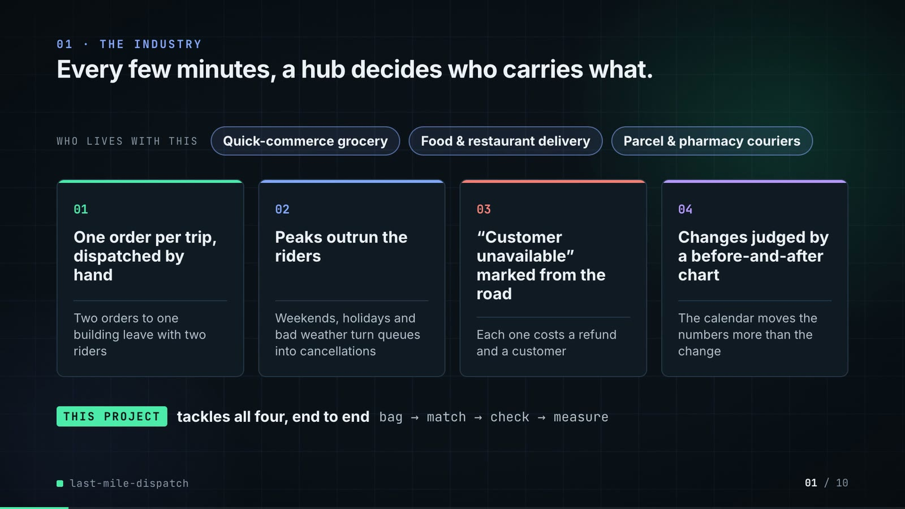

**On-screen text (verbatim)**

> 01 · THE INDUSTRY  
> Every few minutes, a hub decides who carries what.  
> WHO LIVES WITH THIS · Quick-commerce grocery · Food & restaurant delivery · Parcel & pharmacy couriers  
> 01 One order per trip, dispatched by hand — Two orders to one building leave with two riders  
> 02 Peaks outrun the riders — Weekends, holidays and bad weather turn queues into cancellations  
> 03 “Customer unavailable” marked from the road — Each one costs a refund and a customer  
> 04 Changes judged by a before-and-after chart — The calendar moves the numbers more than the change  
> THIS PROJECT tackles all four, end to end · bag → match → check → measure  

**Figures on this slide**

| ID | Shown | Source · key | Calculation | Check |
|---|---|---|---|---|
| F-01 | 3 industry chips | `author's framing` · - | - | manual |
| F-02 | 4 problem cards | `README 'The problem', 'Insights and learning'` · README text | - | ✓ |

**Assumptions:** A-13

**Illustrative, not data:**

- The whole slide is context; no repo figures.

**To change this slide:** Edit the chips (#ctx-c1..3) and cards (#ctx-k1..4) in compositions/s01-context.html. (project folder `docs/demo/source`).

### Slide 02: This project  
*6.8-11.6 s · composition `compositions/s02-hook.html (SERIES block injected by tools/inject_sheet.py)`*

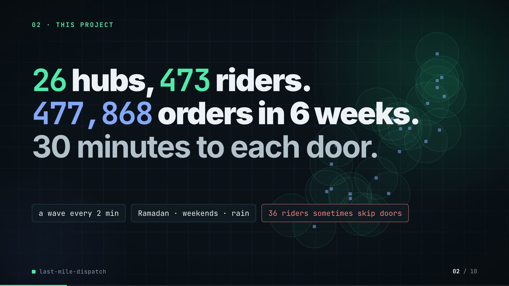

**On-screen text (verbatim)**

> 02 · THIS PROJECT  
> 26 hubs, 473 riders. 477,868 orders in 6 weeks. 30 minutes to each door.  
> a wave every 2 min · Ramadan · weekends · rain · 36 riders sometimes skip doors  

**Figures on this slide**

| ID | Shown | Source · key | Calculation | Check |
|---|---|---|---|---|
| F-03 | 26 hubs | `outputs/summary.json; data/hubs.csv` · hubs; row count | - | ✓ |
| F-04 | 473 riders | `data/riders.csv` · row count | - | ✓ |
| F-05 | 477,868 orders | `data/orders.csv.gz` · row count | - | ✓ |
| F-06 | 6 weeks / 42 days | `data/days.csv` · row count = 42 | 42 / 7 = 6 weeks | ✓ |
| F-07 | 30 minutes to each door / 30-minute promise | `src/last_mile_dispatch/config.py:27` · SLA_MIN = 30 | - | ✓ |
| F-08 | a wave every 2 min / EVERY 2 MINUTES / dispatch wave 2 min | `src/last_mile_dispatch/config.py:23` · WAVE_MIN = 2 | - | ✓ |
| F-09 | Ramadan · weekends · rain | `data/days.csv` · ramadan, weekend, rain columns | any ramadan, any weekend, exactly one rain day | ✓ |
| F-10 | 36 riders sometimes skip doors | `data/riders.csv` · remote_marker == True | count | ✓ |
| F-11 | hub dots + circles | `data/hubs.csv; config.py:12 (SERVICE_RADIUS_KM = 4.0)` · lat/lon -> km from the centroid (demo assets/run_series.json) | - | ✓ |

**Assumptions:** A-01, A-07, A-08, A-10

**Illustrative, not data:**

- The background is the 26 real hub positions with a 4 km service circle each (decoration, low opacity).

**To change this slide:** Headline spans #hook-l1..l3 and chips #hook-f1..f3 in compositions/s02-hook.html; counts come from data/*.csv. (project folder `docs/demo/source`).

### Slide 03: How it works (white chapter, slide A)  
*11.3-19.3 s · composition `compositions/explainer.html (CONFIG.blocks, CONFIG.groups, CONFIG.loop)`*

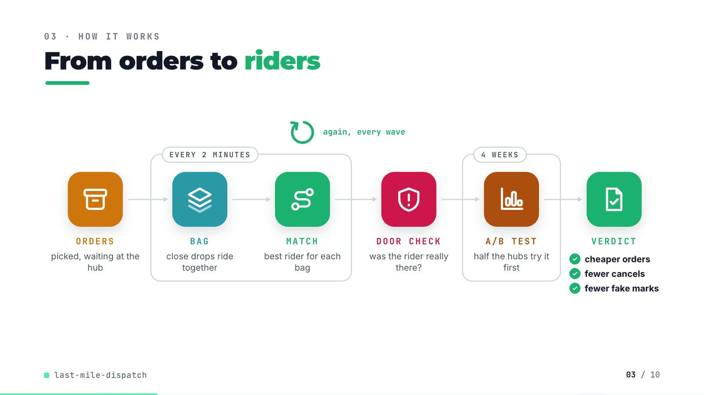

**On-screen text (verbatim)**

> 03 · HOW IT WORKS  
> From orders to riders  
> ORDERS picked, waiting at the hub → [EVERY 2 MINUTES: BAG close drops ride together → MATCH best rider for each bag] → DOOR CHECK was the rider really there? → [4 WEEKS: A/B TEST half the hubs try it first] → VERDICT ✓ cheaper orders ✓ fewer cancels ✓ fewer fake marks  
> again, every wave (loop over MATCH)  

**Figures on this slide**

| ID | Shown | Source · key | Calculation | Check |
|---|---|---|---|---|
| F-08 | a wave every 2 min / EVERY 2 MINUTES / dispatch wave 2 min | `src/last_mile_dispatch/config.py:23` · WAVE_MIN = 2 | - | ✓ |
| F-12 | ORDERS → BAG → MATCH → DOOR CHECK → A/B TEST → VERDICT | `src/last_mile_dispatch/` · functions | - | ✓ |
| F-13 | 4 WEEKS | `outputs/summary.json` · experiment_days = 28 | 28 / 7 = 4 | ✓ |
| F-14 | cheaper orders / fewer cancels / fewer fake marks | `outputs/ab_readout.csv` · welch_hi for cost_per_delivered, cancel_rate, fake_accepted_per_1k | welch_hi < 0 for all three | ✓ |

**Assumptions:** A-05, A-06, A-08, A-09

**Illustrative, not data:**

- Icons and colours are a visual language, not data.

**To change this slide:** Edit CONFIG in compositions/explainer.html; badge truth comes from ab_readout.csv (F-14). (project folder `docs/demo/source`).

### Slide 04: The key idea (white chapter, slide B)  
*19.3-26.3 s · composition `compositions/explainer.html (#ex-b ...)`*

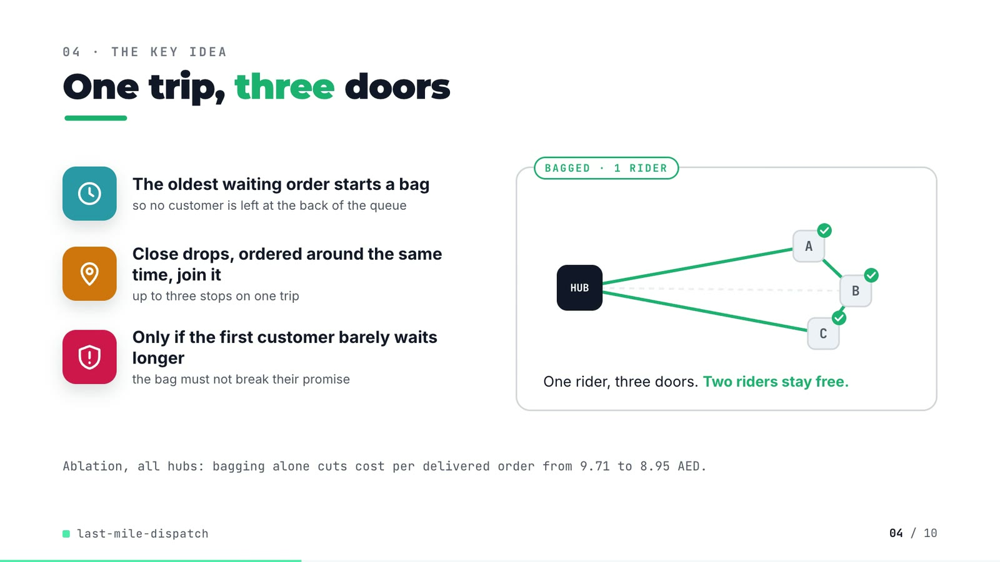

**On-screen text (verbatim)**

> 04 · THE KEY IDEA  
> One trip, three doors  
> The oldest waiting order starts a bag — so no customer is left at the back of the queue  
> Close drops, ordered around the same time, join it — up to three stops on one trip  
> Only if the first customer barely waits longer — the bag must not break their promise  
> ONE ORDER PER TRIP · 3 RIDERS → BAGGED · 1 RIDER (HUB, A, B, C). One rider, three doors. Two riders stay free.  
> Ablation, all hubs: bagging alone cuts cost per delivered order from 9.71 to 8.95 AED.  

**Figures on this slide**

| ID | Shown | Source · key | Calculation | Check |
|---|---|---|---|---|
| F-15 | 3 steps / ≤ 3 stops · 1 km | `src/last_mile_dispatch/bagging.py:3-5, :51-87; config.py:37, :65-67` · BAG_CAPACITY = 3, BAG_MAX_DROP_GAP_KM = 1.0, BAG_MAX_CREATED_GAP_MIN = 12.0, BAG_MAX_EXTRA_MIN = 9.0 | - | ✓ |
| F-16 | 9.71 | `outputs/ablation.csv` · policy=baseline, cost_per_delivered | - | ✓ |
| F-17 | 8.95 AED | `outputs/ablation.csv` · policy=bagging, cost_per_delivered | - | ✓ |

**Assumptions:** A-02, A-05, A-12

**Illustrative, not data:**

- The HUB/A/B/C demo is schematic: it shows the rule in bagging.make_bags, not a real bag.

**To change this slide:** Markup under #ex-b in compositions/explainer.html; the footnote figures are F-16 and F-17. (project folder `docs/demo/source`).

### Slide 05: Architecture  
*26.0-41.0 s · composition `compositions/s03-architecture.html`*

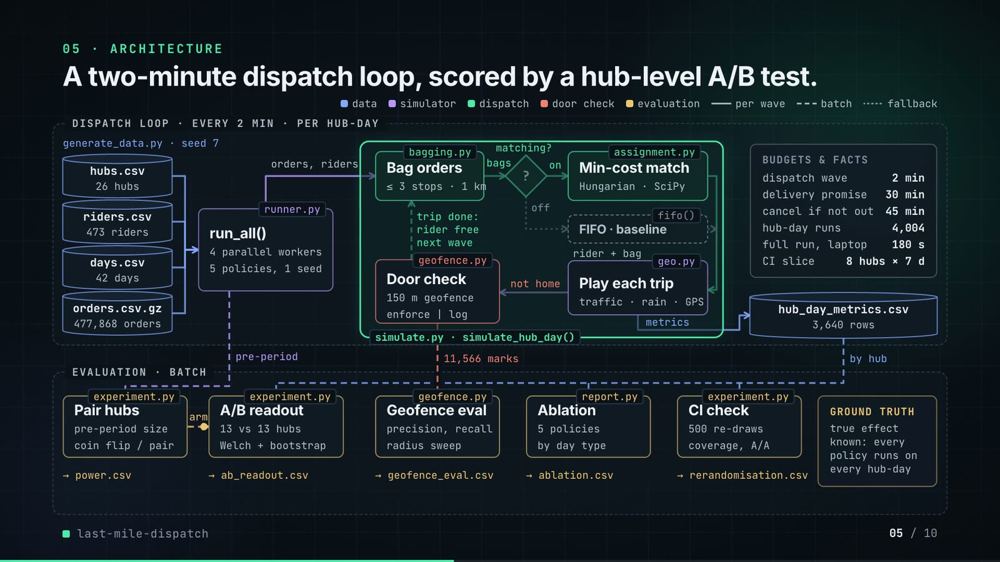

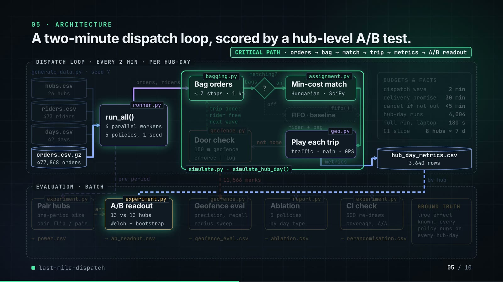

**On-screen text (verbatim)**

> 05 · ARCHITECTURE  
> A two-minute dispatch loop, scored by a hub-level A/B test.  
> Legend: data · simulator · dispatch · door check · evaluation · per wave (solid) · batch (dashed) · fallback (dotted)  
> DISPATCH LOOP · EVERY 2 MIN · PER HUB-DAY — generate_data.py · seed 7: hubs.csv 26 hubs, riders.csv 473 riders, days.csv 42 days, orders.csv.gz 477,868 orders  
> runner.py run_all(): 4 parallel workers, 5 policies, 1 seed → orders, riders →  
> simulate.py · simulate_hub_day(): bagging.py Bag orders (≤ 3 stops · 1 km) → bags → matching? → on → assignment.py Min-cost match (Hungarian · SciPy); off → fifo() FIFO · baseline → rider + bag → geo.py Play each trip (traffic · rain · GPS) → not home → geofence.py Door check (150 m geofence · enforce | log) → trip done: rider free, next wave  
> metrics → hub_day_metrics.csv 3,640 rows · BUDGETS & FACTS: dispatch wave 2 min, delivery promise 30 min, cancel if not out 45 min, hub-day runs 4,004, full run, laptop 180 s, CI slice 8 hubs × 7 d  
> EVALUATION · BATCH: experiment.py Pair hubs (pre-period size, coin flip / pair) → arm → experiment.py A/B readout (13 vs 13 hubs, Welch + bootstrap) → ab_readout.csv; geofence.py Geofence eval (precision, recall, radius sweep) ← 11,566 marks → geofence_eval.csv; report.py Ablation (5 policies, by day type) → ablation.csv; experiment.py CI check (500 re-draws, coverage, A/A) → rerandomisation.csv; → power.csv; GROUND TRUTH: true effect known: every policy runs on every hub-day  
> CRITICAL PATH · orders → bag → match → trip → metrics → A/B readout  

**Figures on this slide**

| ID | Shown | Source · key | Calculation | Check |
|---|---|---|---|---|
| F-03 | 26 hubs | `outputs/summary.json; data/hubs.csv` · hubs; row count | - | ✓ |
| F-04 | 473 riders | `data/riders.csv` · row count | - | ✓ |
| F-05 | 477,868 orders | `data/orders.csv.gz` · row count | - | ✓ |
| F-06 | 6 weeks / 42 days | `data/days.csv` · row count = 42 | 42 / 7 = 6 weeks | ✓ |
| F-08 | a wave every 2 min / EVERY 2 MINUTES / dispatch wave 2 min | `src/last_mile_dispatch/config.py:23` · WAVE_MIN = 2 | - | ✓ |
| F-15 | 3 steps / ≤ 3 stops · 1 km | `src/last_mile_dispatch/bagging.py:3-5, :51-87; config.py:37, :65-67` · BAG_CAPACITY = 3, BAG_MAX_DROP_GAP_KM = 1.0, BAG_MAX_CREATED_GAP_MIN = 12.0, BAG_MAX_EXTRA_MIN = 9.0 | - | ✓ |
| F-18 | generate_data.py, runner.py run_all(), simulate.py simulate_hub_day(), bagging.py, assignment.py (min_cost, fifo), geo.py, geofence.py, experiment.py, report.py | `src/last_mile_dispatch/, scripts/` · defs | - | ✓ |
| F-19 | power.csv, ab_readout.csv, geofence_eval.csv, ablation.csv, rerandomisation.csv, hub_day_metrics.csv | `outputs/` · files | - | ✓ |
| F-20 | 3,640 rows | `outputs/hub_day_metrics.csv` · row count | 26 x 28 x 5 | ✓ |
| F-21 | 11,566 marks | `outputs/geofence_eval.csv` · slice=all, events | - | ✓ |
| F-22 | hub-day runs 4,004 | `outputs/run_log.txt line 2` · 'simulated 4,004 hub-day-policy runs' | 26 x 14 + 26 x 28 x 5 = 4,004 | ✓ |
| F-23 | full run, laptop 180 s | `outputs/summary.json` · runtime_s = 179.8 | rounded to whole seconds | ✓ |
| F-24 | cancel if not out 45 min | `src/last_mile_dispatch/config.py:28` · CANCEL_AFTER_MIN = 45 | - | ✓ |
| F-25 | 150 m geofence | `src/last_mile_dispatch/config.py:79` · GEOFENCE_RADIUS_M = 150.0 | - | ✓ |
| F-26 | 500 re-draws | `outputs/rerandomisation.csv` · draws | - | ✓ |
| F-27 | 13 vs 13 hubs | `outputs/summary.json` · arms.treatment, arms.control | len of each list | ✓ |
| F-28 | 4 parallel workers · 5 policies, 1 seed | `src/last_mile_dispatch/cli.py:29; runner.py:36-41; config.py:62` · --workers default 4; same seed for every policy; ALL_POLICIES | - | ✓ |
| F-29 | CI slice 8 hubs × 7 d | `src/last_mile_dispatch/cli.py:38, :40; .github/workflows/ci.yml` · hubs.head(8), experiment days head(7) | - | ✓ |
| F-30 | generate_data.py · seed 7 | `scripts/generate_data.py:168` · --seed default 7 | - | ✓ |

**Assumptions:** A-01, A-03, A-04, A-05, A-06, A-08, A-09

**Illustrative, not data:**

- Packets moving along the wires are decoration in execution order (the dispatch loop turns twice).
- 'per wave' (solid) vs 'batch' (dashed) marks what runs inside each 2-minute wave and what runs after all hub-days.
- The '?' diamond is the decision point Policy.matching (config.py); the dotted path is the FIFO fallback used by the baseline.
- The critical-path highlight is the chain that produces the headline A/B numbers.

**To change this slide:** Node boxes (#n-*), cylinders (CYL) and the W wires object in compositions/s03-architecture.html. (project folder `docs/demo/source`).

### Slide 06: The system running  
*40.6-53.2 s · composition `compositions/s04-routes.html (SERIES block injected by tools/inject_sheet.py from tools/export_series.py)`*

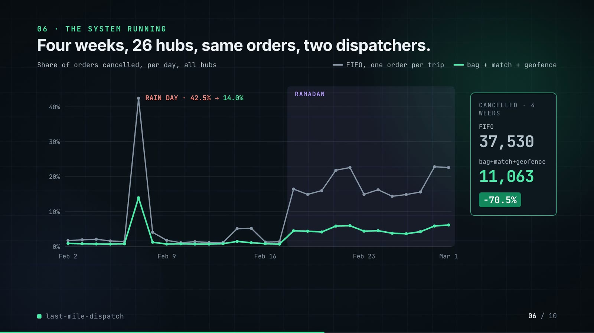

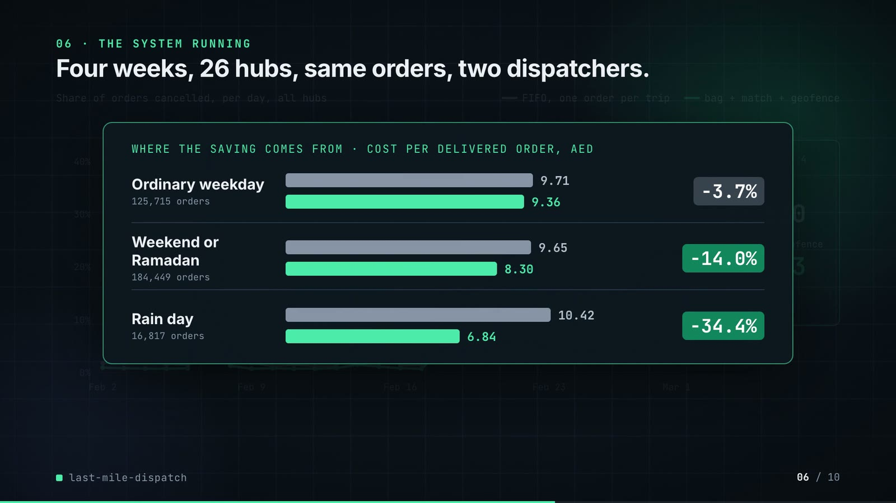

**On-screen text (verbatim)**

> 06 · THE SYSTEM RUNNING  
> Four weeks, 26 hubs, same orders, two dispatchers.  
> Share of orders cancelled, per day, all hubs · FIFO, one order per trip vs bag + match + geofence · RAMADAN band · RAIN DAY · 42.5% → 14.0%  
> CANCELLED · 4 WEEKS: FIFO 37,530 · bag+match+geofence 11,063 · −70.5%  
> WHERE THE SAVING COMES FROM · COST PER DELIVERED ORDER, AED: Ordinary weekday (125,715 orders) 9.71 → 9.36 −3.7% · Weekend or Ramadan (184,449 orders) 9.65 → 8.30 −14.0% · Rain day (16,817 orders) 10.42 → 6.84 −34.4%  

**Figures on this slide**

| ID | Shown | Source · key | Calculation | Check |
|---|---|---|---|---|
| F-31 | two lines, Feb 2 - Mar 1 | `outputs/hub_day_metrics.csv` · sum(cancelled) / sum(orders) by date and policy | injected SERIES block must equal the recomputation | ✓ |
| F-32 | RAIN DAY · 42.5% → 14.0% | `outputs/stress_split.csv` · day_type=rain day, cancel_rate | x 100 | ✓ |
| F-33 | 37,530 → 11,063 | `outputs/hub_day_metrics.csv` · sum(cancelled) by policy | - | ✓ |
| F-34 | −70.5% | `outputs/hub_day_metrics.csv` · F-33 | (11,063 / 37,530 - 1) x 100 = -70.52% | ✓ |
| F-35 | 125,715 orders · 9.71 → 9.36 · −3.7% | `outputs/stress_split.csv` · day_type=ordinary weekday | cost_treat / cost_base - 1 | ✓ |
| F-36 | 184,449 orders · 9.65 → 8.30 · −14.0% | `outputs/stress_split.csv` · day_type=weekend or Ramadan | cost_treat / cost_base - 1 | ✓ |
| F-37 | 16,817 orders · 10.42 → 6.84 · −34.4% | `outputs/stress_split.csv` · day_type=rain day | cost_treat / cost_base - 1 | ✓ |
| F-38 | RAMADAN band from Feb 18 | `data/days.csv` · first date with ramadan = True | - | ✓ |

**Assumptions:** A-02, A-03, A-08, A-10

**Illustrative, not data:**

- Chart and bars are drawn from the injected numbers (no hand-typed data points); bars are to scale from zero.

**To change this slide:** Re-run tools/export_series.py and inject it (--name SERIES); layout in compositions/s04-routes.html. (project folder `docs/demo/source`).

### Slide 07: End-user value (white)  
*52.9-65.9 s · composition `compositions/value.html (SHEET block injected by tools/inject_sheet.py from tools/export_rider_board.py)`*

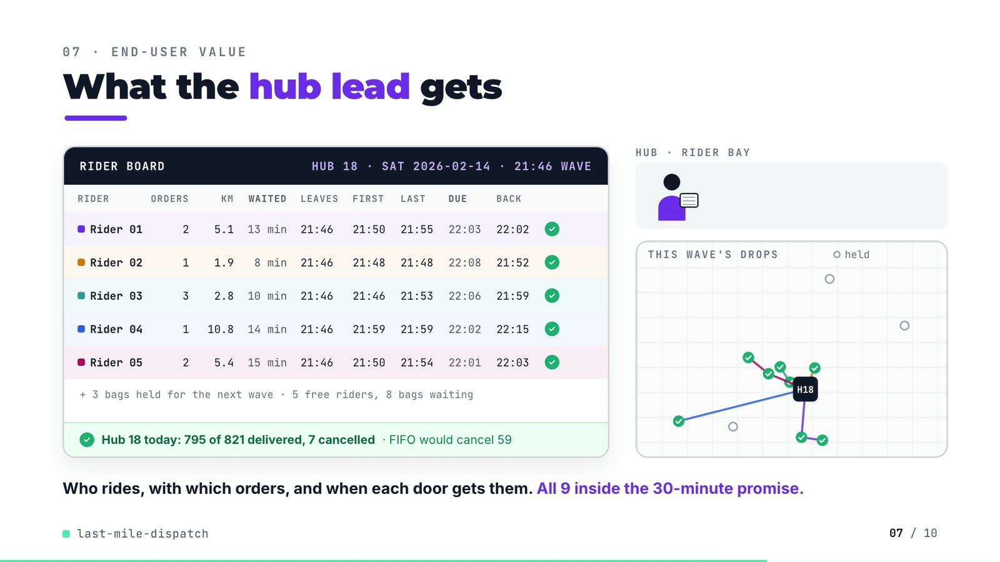

**On-screen text (verbatim)**

> 07 · END-USER VALUE  
> What the hub lead gets  
> RIDER BOARD · HUB 18 · SAT 2026-02-14 · 21:46 WAVE — columns RIDER, ORDERS, KM, WAITED, LEAVES, FIRST, LAST, DUE, BACK  
> Rider 01 2 5.1 13 min 21:46 21:50 21:55 22:03 22:02 ✓  
> Rider 02 1 1.9 8 min 21:46 21:48 21:48 22:08 21:52 ✓  
> Rider 03 3 2.8 10 min 21:46 21:46 21:53 22:06 21:59 ✓  
> Rider 04 1 10.8 14 min 21:46 21:59 21:59 22:02 22:15 ✓  
> Rider 05 2 5.4 15 min 21:46 21:50 21:54 22:01 22:03 ✓  
> + 3 bags held for the next wave · 5 free riders, 8 bags waiting  
> ✓ Hub 18 today: 795 of 821 delivered, 7 cancelled · FIFO would cancel 59  
> HUB · RIDER BAY · THIS WAVE'S DROPS · held  
> Who rides, with which orders, and when each door gets them. All 9 inside the 30-minute promise.  

**Figures on this slide**

| ID | Shown | Source · key | Calculation | Check |
|---|---|---|---|---|
| F-03 | 26 hubs | `outputs/summary.json; data/hubs.csv` · hubs; row count | - | ✓ |
| F-07 | 30 minutes to each door / 30-minute promise | `src/last_mile_dispatch/config.py:27` · SLA_MIN = 30 | - | ✓ |
| F-39 | Rider 01-05 rows | `demo assets/rider_board.json (re-run of the repo's simulator), injected into compositions/value.html` · rows | km = sum of road legs; waited = wave time - oldest order's creation; due = earliest creation + 30 min | ✓ |
| F-40 | 795 of 821 delivered, 7 cancelled · FIFO would cancel 59 | `outputs/hub_day_metrics.csv` · hub_id=18, date=2026-02-14, policy in {bagging+matching+geofence, baseline} | - | ✓ |
| F-41 | + 3 bags held for the next wave · 5 free riders, 8 bags waiting | `demo assets/rider_board.json` · bags_held, free_riders, bags_waiting_before | held = bags waiting - riders matched | ✓ |
| F-42 | All 9 inside the 30-minute promise. | `demo assets/rider_board.json` · orders_dispatched; stops[].on_time | every stop ETA - creation <= 30 min | ✓ |
| F-43 | HUB 18 | `outputs/summary.json` · arms.treatment | - | ✓ |

**Assumptions:** A-03, A-04, A-05, A-08, A-11

**Illustrative, not data:**

- Rider 01-05 are placeholders (no real people); all five are on bikes.
- The hub-lead figure, rider bay, scooter drawings and driving speed are illustrative; drop positions and stop order are real, scaled to fit the panel (uniform scale).
- Grey circles are the drops of the 3 bags held for the next wave.

**To change this slide:** Re-run tools/export_rider_board.py (hub, date, wave arguments), then tools/inject_sheet.py --name SHEET; layout in compositions/value.html. (project folder `docs/demo/source`).

### Slide 08: Results  
*65.6-74.4 s · composition `compositions/s05-results.html (stats array)`*

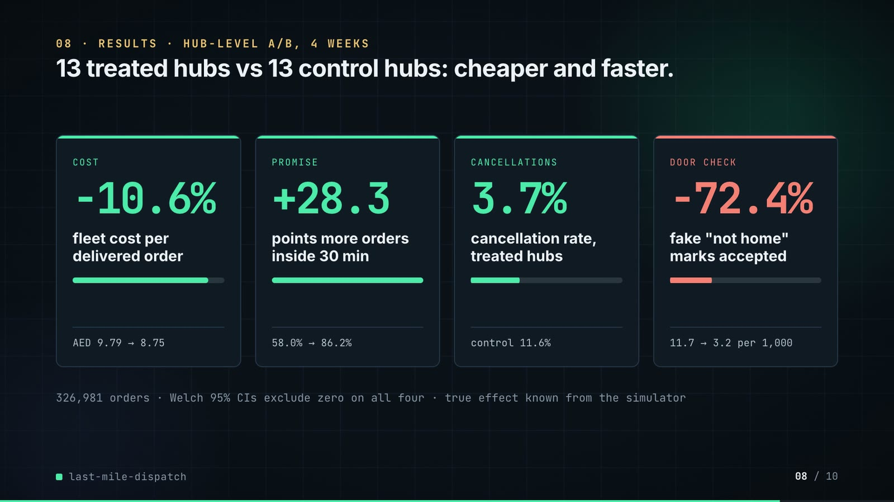

**On-screen text (verbatim)**

> 08 · RESULTS · HUB-LEVEL A/B, 4 WEEKS  
> 13 treated hubs vs 13 control hubs: cheaper and faster.  
> COST −10.6% fleet cost per delivered order · AED 9.79 → 8.75  
> PROMISE +28.3 points more orders inside 30 min · 58.0% → 86.2%  
> CANCELLATIONS 3.7% cancellation rate, treated hubs · control 11.6%  
> DOOR CHECK −72.4% fake "not home" marks accepted · 11.7 → 3.2 per 1,000  
> 326,981 orders · Welch 95% CIs exclude zero on all four · true effect known from the simulator  

**Figures on this slide**

| ID | Shown | Source · key | Calculation | Check |
|---|---|---|---|---|
| F-27 | 13 vs 13 hubs | `outputs/summary.json` · arms.treatment, arms.control | len of each list | ✓ |
| F-44 | −10.6% | `outputs/ab_readout.csv` · metric=cost_per_delivered, rel_diff | x 100 | ✓ |
| F-45 | AED 9.79 → 8.75 | `outputs/ab_readout.csv` · metric=cost_per_delivered, control, treatment | - | ✓ |
| F-46 | +28.3 | `outputs/ab_readout.csv` · metric=on_time_share_of_orders, diff | x 100 | ✓ |
| F-47 | 58.0% → 86.2% | `outputs/ab_readout.csv` · metric=on_time_share_of_orders, control, treatment | x 100 | ✓ |
| F-48 | 3.7% · control 11.6% | `outputs/ab_readout.csv` · metric=cancel_rate, treatment, control | x 100 | ✓ |
| F-49 | −72.4% | `outputs/ab_readout.csv` · metric=fake_accepted_per_1k, rel_diff | x 100 | ✓ |
| F-50 | 11.7 → 3.2 per 1,000 | `outputs/ab_readout.csv` · metric=fake_accepted_per_1k, control, treatment | - | ✓ |
| F-51 | 326,981 orders | `outputs/summary.json` · orders_in_experiment | - | ✓ |
| F-52 | Welch 95% CIs exclude zero on all four | `outputs/ab_readout.csv` · welch_lo, welch_hi | lo > 0 or hi < 0 for cost, on-time, cancel, fake | ✓ |

**Assumptions:** A-02, A-03, A-04, A-06, A-09, A-12

**Illustrative, not data:**

- Mini bars under each number are drawn to the same ratio (treatment / control).

**To change this slide:** The stats array and card text in compositions/s05-results.html. (project folder `docs/demo/source`).

### Slide 09: What didn't win  
*74.0-80.6 s · composition `compositions/s06-twist.html`*

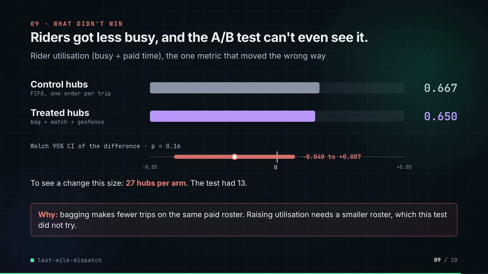

**On-screen text (verbatim)**

> 09 · WHAT DIDN'T WIN  
> Riders got less busy, and the A/B test can't even see it.  
> Rider utilisation (busy ÷ paid time), the one metric that moved the wrong way  
> Control hubs (FIFO, one order per trip) 0.667 · Treated hubs (bag + match + geofence) 0.650  
> Welch 95% CI of the difference · p = 0.16 · −0.040 to +0.007 (axis −0.05 … 0 … +0.05)  
> To see a change this size: 27 hubs per arm. The test had 13.  
> Why: bagging makes fewer trips on the same paid roster. Raising utilisation needs a smaller roster, which this test did not try.  

**Figures on this slide**

| ID | Shown | Source · key | Calculation | Check |
|---|---|---|---|---|
| F-27 | 13 vs 13 hubs | `outputs/summary.json` · arms.treatment, arms.control | len of each list | ✓ |
| F-53 | 0.667 / 0.650 | `outputs/ab_readout.csv` · metric=utilization, control, treatment | - | ✓ |
| F-54 | −0.040 to +0.007 | `outputs/ab_readout.csv` · metric=utilization, welch_lo, welch_hi | - | ✓ |
| F-55 | p = 0.16 | `outputs/ab_readout.csv` · metric=utilization, welch_p | - | ✓ |
| F-56 | 27 hubs per arm | `outputs/power.csv` · metric=utilization, hubs_per_arm_needed | - | ✓ |
| F-57 | axis −0.05..+0.05 = 1,000 px; bar 95 → 571 px, estimate at 333 px | `compositions/s06-twist.html; outputs/ab_readout.csv` · welch_lo, welch_hi, diff | px = (v + 0.05) x 10,000 | ✓ |

**Assumptions:** A-02, A-09, A-12

**Illustrative, not data:**

- Utilisation bars: 1,000 px track = 1.0 (from zero).

**To change this slide:** Rows #twist-r1..r2 and the CI strip (#twist-ci) in compositions/s06-twist.html. (project folder `docs/demo/source`).

### Slide 10: End card  
*80.2-84.6 s · composition `compositions/s07-end.html`*


**On-screen text (verbatim)**

> 10 · OPEN SOURCE · MIT · RUNS ON A LAPTOP  
> last-mile-dispatch  
> github.com/kavya2693/last-mile-dispatch  
> SciPy · pandas · NumPy · Python  
> $ make run   # 26 hubs, 4 weeks, ~3 min  

**Figures on this slide**

| ID | Shown | Source · key | Calculation | Check |
|---|---|---|---|---|
| F-11 | hub dots + circles | `data/hubs.csv; config.py:12 (SERVICE_RADIUS_KM = 4.0)` · lat/lon -> km from the centroid (demo assets/run_series.json) | - | ✓ |
| F-58 | MIT | `LICENSE line 1` · - | - | ✓ |
| F-59 | ~3 min | `outputs/summary.json` · runtime_s = 179.8 | 179.8 / 60 = 3.0 min | ✓ |
| F-60 | SciPy · pandas · NumPy · Python | `pyproject.toml dependencies` · numpy, pandas, scipy | - | ✓ |
| F-61 | $ make run   # 26 hubs, 4 weeks, ~3 min | `Makefile; outputs/summary.json` · run target; hubs; experiment_days | - | ✓ |

**Assumptions:** A-12

**Illustrative, not data:**

- Faded background: the 26 real hub positions with 4 km circles.

**To change this slide:** Text in compositions/s07-end.html. (project folder `docs/demo/source`).

## 5. Change-impact matrix

| Input / assumption | Affected figures | Affected slides | Files to edit | Commands to re-run |
|---|---|---|---|---|
| A-01: All data is synthetic, produced by a seeded generator sized to the production problem (26 hubs, 473 riders, 42 days, 477,868 orders) | all figures | 01, 02, 03, 04, 05, 06, 07, 08, 09, 10 | `scripts/generate_data.py; src/last_mile_dispatch/config.py` | `make data; make run` |
| A-02: The rider roster is fixed and sized for an ordinary weekday evening; every policy pays for the same riders | F-04, F-33, F-34, F-35, F-36, F-37, F-44, F-45, F-53, F-54, F-55, F-56 | 02, 05, 06, 08, 09 | `scripts/generate_data.py:84-85` | `make data; make run` |
| A-03: Travel is straight-line distance x 1 | F-32, F-33, F-34, F-35, F-36, F-37, F-39, F-44, F-45, F-46, F-47 | 06, 07, 08 | `src/last_mile_dispatch/config.py:13, :36; src/last_mile_dispatch/geo.py:29-41` | `make run; export_rider_board.py + inject_sheet.py` |
| A-04: Matching prices each rider-bag pair in AED: km cost of the vehicle, 1 | F-14, F-33, F-34, F-39, F-44, F-45, F-46, F-47, F-48 | 03, 06, 07, 08 | `src/last_mile_dispatch/config.py:74-76` | `make run; export_rider_board.py + inject_sheet.py` |
| A-05: Bagging limits: drops within 1 km and created within 12 minutes of the seed order, at most 3 stops, and the first customer may wait at most 9 extra minutes | F-15, F-16, F-17, F-39, F-41 | 04, 05, 07 | `src/last_mile_dispatch/config.py:37, :65-67` | `make run; export_rider_board.py + inject_sheet.py` |
| A-06: Geofence rule: a 'customer unavailable' mark is flagged when fewer than 2 of the rider's last 6 GPS pings are within 150 m of the customer; flagged riders are sent back to the door (treatment) or the flag is only logged (baseline) | F-21, F-25, F-49, F-50 | 05, 08 | `src/last_mile_dispatch/config.py:79-80` | `make run` |
| A-07: Fake marks: about 8% of riders (36 of 473 in the data) mark 'customer unavailable' without reaching the door on 22% of their stops; fakes are known by construction and riders do not change habit when flagged | F-10, F-21, F-49, F-50 | 02, 05, 08 | `src/last_mile_dispatch/config.py:40-41` | `make data; make run` |
| A-08: Service promise 30 minutes from order creation; a customer cancels if nothing has left the hub after 45 minutes; the dispatcher wakes every 2 minutes; 2 minutes handover per stop | F-07, F-08, F-24, F-32, F-33, F-34, F-42, F-46, F-47, F-48 | 02, 03, 05, 06, 07, 08 | `src/last_mile_dispatch/config.py:23-29` | `make run; export_rider_board.py + inject_sheet.py` |
| A-09: Experiment design: hubs sorted by pre-period orders per day, paired, one coin flip per pair (seed 2026); one number per hub over four weeks; Welch t and hub-bootstrap 95% intervals; power from the pre-period between-hub spread | F-27, F-44, F-45, F-46, F-47, F-48, F-49, F-50, F-52, F-53, F-54, F-55, F-56, F-57 | 05, 08, 09 | `src/last_mile_dispatch/cli.py:22; src/last_mile_dispatch/experiment.py` | `make run` |
| A-10: Calendar: two pre-period weeks from 2026-01-19, then four experiment weeks 2026-02-02 to 2026-03-01; weekends are Saturday-Sunday; Ramadan from 2026-02-18; one rain day 2026-02-07 (35% more orders, 40% slower traffic) | F-06, F-09, F-13, F-31, F-32, F-35, F-36, F-37, F-38, F-40 | 02, 03, 05, 06, 07 | `src/last_mile_dispatch/config.py:16-18; scripts/generate_data.py:35-36` | `make data; make run` |
| A-11: The rider board (slide 07) re-runs the repo's own simulator for hub 18 on 2026-02-14 under the treatment and records the 21:46 wave; drop ETAs replay the simulator's clock with geo | F-39, F-40, F-41, F-42 | 07 | `docs/demo/source/tools/export_rider_board.py (hub, date, wave arguments)` | `export_rider_board.py + inject_sheet.py; hyperframes render` |
| A-12: Video rounding: percentages to 1 decimal, AED to 2 decimals, utilisation and CI bounds to 3 decimals, counts with thousands separators; '~3 min' and '180 s' are rounded run times | F-16, F-17, F-23, F-32, F-34, F-35, F-36, F-37, F-44, F-45, F-46, F-47, F-48, F-49, F-50, F-53, F-54, F-55, F-59 | 04, 05, 06, 08, 09, 10 | `the composition file named on each slide` | `hyperframes render` |
| A-13: Slide 01 (industries, everyday problems) is general delivery-operations knowledge used as context | F-01, F-02 | 01 | `compositions/s01-context.html` | `hyperframes render` |

## 6. Known differences and caveats

- Everything is simulated (A-01). The A/B readout is what an experimenter would see; the 'true effect' is known only because every policy ran on every hub-day with the same random draws.
- The cost saving is mostly cancellations turned into deliveries on a fixed, paid roster (A-02); slide 06 shows it is under 4% on an ordinary weekday and 34% on the rain day.
- Slide 07's ETAs are reconstructed with the repo's travel function for one wave; they equal the simulator's delivery times because the five riders are honest and all nine customers are home (asserted in export_rider_board.py).
- Slide 08 uses hub-level means (13 vs 13); the ablation numbers on slide 04 pool every hub and every day, so they differ slightly from the A/B means.
- '36 riders sometimes skip doors' is a generator setting (8% of riders, 22% of their stops), not an observed behaviour (A-07).
- Slide 01 statements are general industry knowledge (A-13).
- Rider names on slide 07 are placeholders.

## Appendix: environment

- Commit: `c7de8a6ad78ef3961f773e55ae9af197085c3f9c`
- Python: 3.11.7
- numpy 2.4.6
- pandas 3.0.6
- scipy 1.17.1
- Profile / seeds: data=7, hub_assignment=2026, rerandomisation=2027, simulator=hub_id * 10000 + day index (same for every policy)
- Run time: summary.json runtime_s = 179.8 s (about 3 min) for make run with 4 workers on the author's laptop
